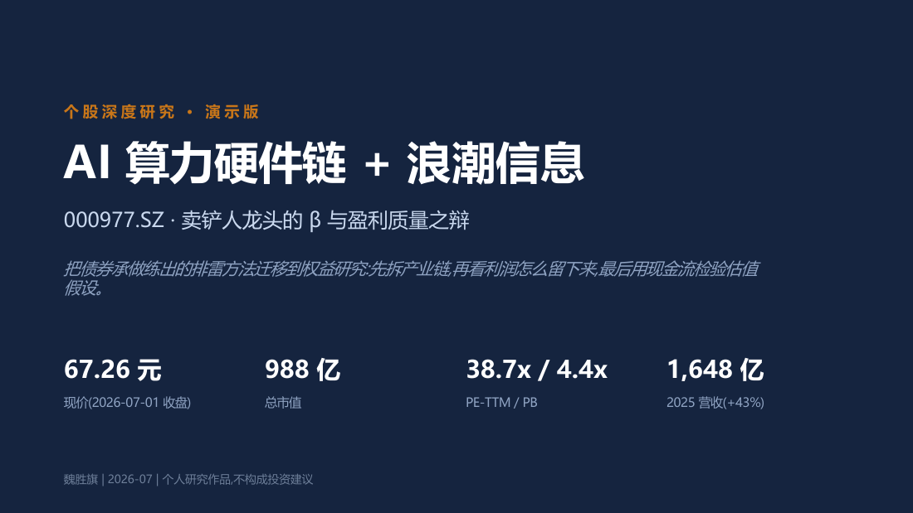
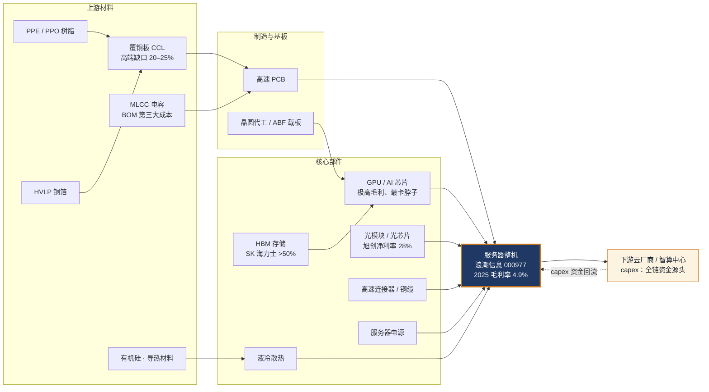
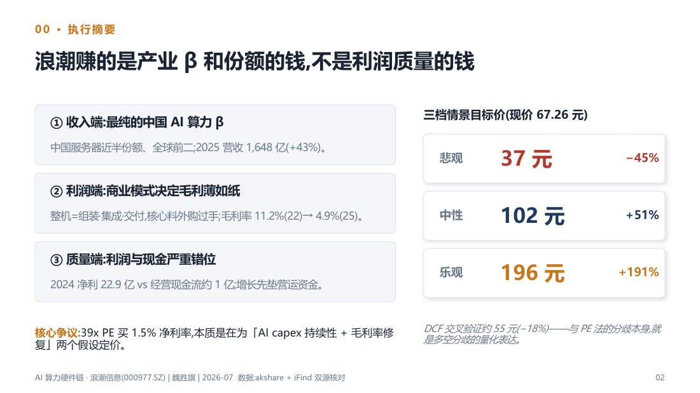
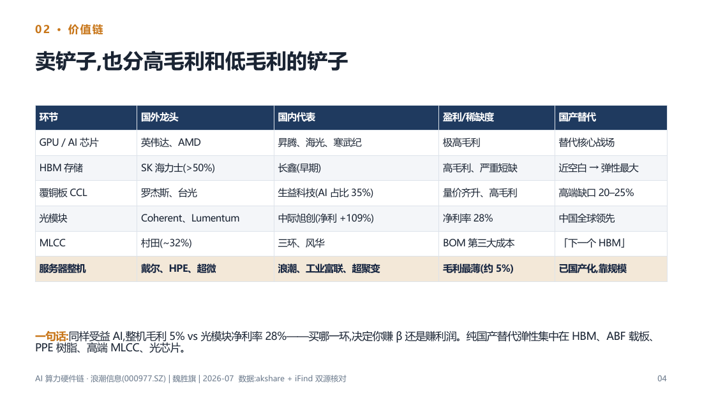
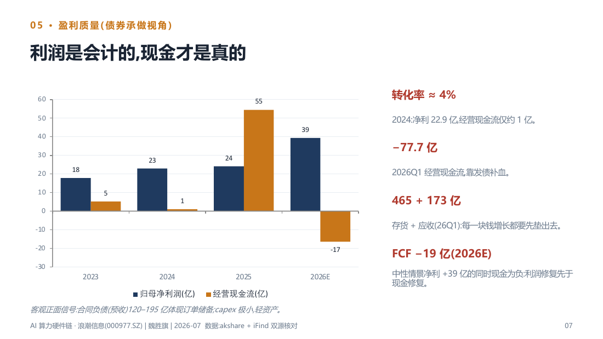
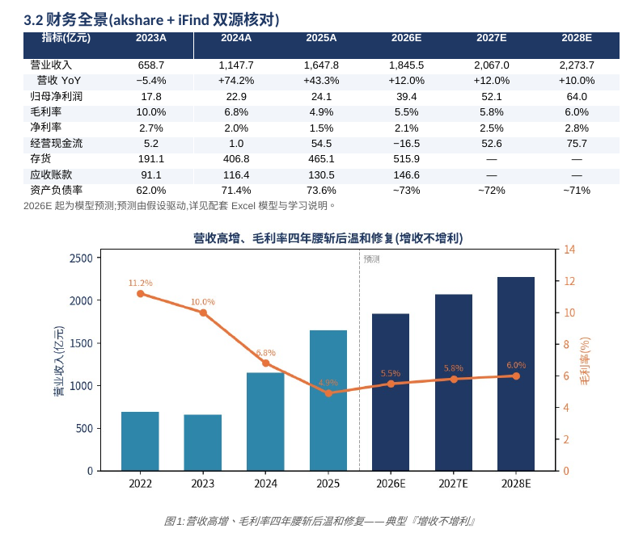
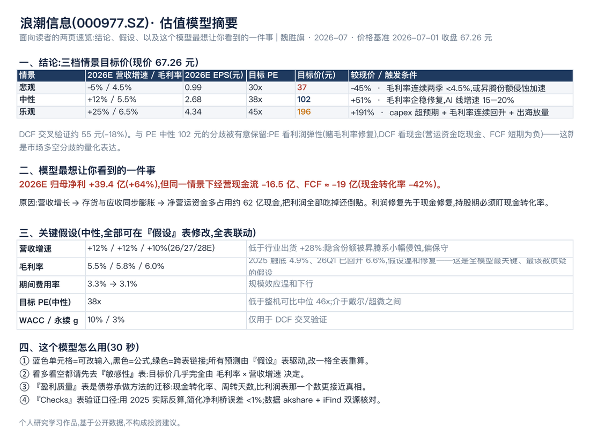
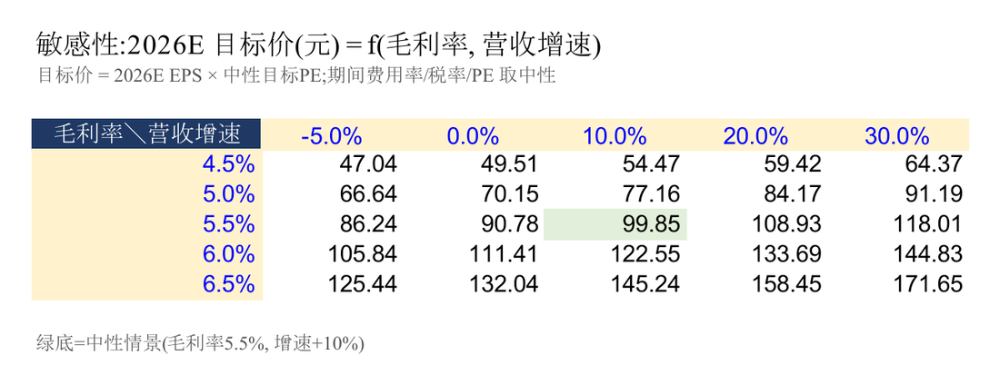

<div align="center">

# AI 算力硬件链 + 浪潮信息（000977）深度研究
<sub>AI Compute Hardware Chain &amp; Inspur Electronic Information (000977.SZ) — Equity Research</sub>

自上而下拆 AI 算力硬件全产业链，自下而上做浪潮信息个股深度：一份报告、一页纸、一套 10 页演示和一个可联动的估值模型。</br>
*A top-down AI hardware value-chain study plus a bottom-up deep dive on Inspur (000977.SZ): report, one-pager, 10-slide deck and a live valuation model.*




[深度报告 PDF](docs/01_AI算力硬件链+浪潮信息_深度报告.pdf) · [一页纸](docs/02_AI算力链+浪潮信息_一页纸.md) · [10 页演示](docs/03_AI算力链+浪潮信息_10页演示.pdf) · [估值模型](docs/04_浪潮信息_盈利预测与估值模型.xlsx) · [作者主页](https://charles77.com)

</div>

> 浪潮信息是中国 AI 算力最纯的 β：中国 AI 服务器近半份额、全球前二，2025 年营收 1,647.8 亿元（+43%）。但整机环节毛利率只有 4.9%、净利率 1.5%，增长要先垫营运资金。当前约 39x PE，本质是在为「AI capex 持续性 + 毛利率能否修复」这两个假设定价。本研究不喊单点买卖，给三档情景目标价和切换条件。

## 目录

- [核心结论](#核心结论)
- [内容一览](#内容一览)
- [产业链地图](#产业链地图)
- [研究方法](#研究方法)
- [页面预览](#页面预览)
- [仓库结构](#仓库结构)
- [如何阅读](#如何阅读)
- [说明与免责](#说明与免责)

## 核心结论

<table>
<tr>
<td width="33%" align="center"><sub>悲观</sub><br/><b>37 元</b><br/><sub>−45% · 30x PE</sub></td>
<td width="34%" align="center"><sub>中性（基准）</sub><br/><b>102 元</b><br/><sub>+51% · 38x PE</sub></td>
<td width="33%" align="center"><sub>乐观</sub><br/><b>196 元</b><br/><sub>+191% · 45x PE</sub></td>
</tr>
</table>

<sub>现价 67.26 元（2026-07-01 收盘），总市值约 988 亿元；DCF 交叉验证约 55 元（−18%）。</sub>

1. **评级取向：情景化，不喊单点买卖。** 中性目标价约 102 元（2026E EPS 2.68 元 × 38x），合理区间 37–196 元。区间宽，原因是净利率只有 1.5%，毛利率每变动 0.5 个点，利润就会被放大成几十个百分点的波动。
2. **盈利预测（中性）：** 营收 2026E / 2027E / 2028E 为 1,845.5 / 2,067.0 / 2,273.7 亿元（+12% / +12% / +10%），归母净利润 39.4 / 52.1 / 64.0 亿元，毛利率 5.5% / 5.8% / 6.0%。营收增速低于行业 2026 年出货 +28%，隐含份额被昇腾系小幅侵蚀，属于偏保守的假设。
3. **估值区间：** PE-TTM 38.7x，低于整机可比中位数约 46x（工业富联 34x / 紫光 40x / 神码 52x / 曙光 68x），PS-TTM 仅 0.64x。折价有基本面原因：浪潮净利率为组内最低，2026Q1 也是组内唯一营收负增长的公司。低估值不等于被低估。
4. **盈利质量是多空分歧点：** 2024 年净利润 22.9 亿元，经营现金流只有约 1 亿元（转化率约 4%）；2026Q1 经营现金流 −77.7 亿元。模型中性情景下 2026E 净利润 +64%，但经营现金流 −16.5 亿元、FCF 约 −19 亿元：利润修复会先于现金修复。
5. **PE 与 DCF 的分歧被保留：** PE 法看利润弹性（押注毛利率修复），DCF 看现金（营运资金占用、FCF 短期为负）。两者相差约一倍，这个差距本身就是对市场多空分歧的量化。

## 内容一览

| 文件 | 一句话 | 链接 |
|---|---|---|
| 深度报告（8 页） | 行业全产业链 + 个股深度：财务全景、盈利质量、分部拆分、可比公司、三档估值与 DCF、跟踪框架，含 6 张图 | [PDF](docs/01_AI算力硬件链+浪潮信息_深度报告.pdf) |
| 一页纸 | 一页读完：核心逻辑、反方观点、三档情景与触发条件、跟踪清单 | [Markdown](docs/02_AI算力链+浪潮信息_一页纸.md) |
| 10 页演示 | 从执行摘要到跟踪框架的 10 页演示版本，图表可编辑 | [PDF](docs/03_AI算力链+浪潮信息_10页演示.pdf) · [PPTX](docs/03_AI算力链+浪潮信息_10页演示.pptx) |
| 盈利预测与估值模型（说明版） | 说明版工作簿，首页「模型摘要」即报告中所说的模型学习说明。11 个工作表：模型摘要、假设、利润表、营运资金与现金流、分部拆分、估值、可比公司、敏感性、盈利质量、Checks；改蓝色假设格即可全表联动 | [XLSX](docs/04_浪潮信息_盈利预测与估值模型.xlsx) |

## 产业链地图

报告覆盖的环节（自上游材料到下游需求；资金方向相反，从云厂商 capex 一路向上游分配）：



<sub>越往上游、越稀缺的环节毛利越高、国产替代弹性越大；整机营收弹性最大，但毛利最薄。各环节国内外龙头对照见报告 2.2 节。</sub>

## 研究方法

1. **拆产业链**：沿「云厂商 capex → 整机 → 核心部件 → 上游材料」梳理 14 个环节，逐一对照国内外龙头、价值量和国产替代程度。
2. **看利润留在哪**：用「营收增速 × 净利率」对照整机与配套环节，例如浪潮毛利约 5%，中际旭创净利率 28%、PE 91x。
3. **财务全景与盈利质量**：akshare 与同花顺 iFind 双源核对 2022–2026Q1 财务数据，重点看净利润与经营现金流的背离、存货与应收占用、合同负债。
4. **假设驱动的预测**：营收增速、毛利率、费用率、营运资金天数集中在「假设」表；AI / 通用服务器分部拆分用来检验营收假设隐含的份额变化。
5. **多方法估值**：以 PE 三档情景为主锚，可比公司对照，DCF 做交叉验证；5×5 敏感性矩阵（毛利率 × 营收增速）给出 47–172 元的目标价分布。
6. **跟踪框架**：季度毛利率 → OCF / 净利润转化率 → 存货与应收周转 → 合同负债 → 中国 AI 服务器份额 → 大厂 capex 指引；毛利率连续两季低于 4.5% 即切换到悲观档。

## 页面预览

<table>
<tr>
<td width="50%"><br/><sub><b>执行摘要</b>：三条逻辑与三档情景目标价</sub></td>
<td width="50%"><br/><sub><b>价值链</b>：同样卖铲子，整机毛利 5% 对比光模块净利率 28%</sub></td>
</tr>
<tr>
<td width="50%"><br/><sub><b>盈利质量</b>：净利润与经营现金流的背离，营运资金占用</sub></td>
<td width="50%"><br/><sub><b>报告 3.2 节</b>：2023A–2028E 财务全景与「营收高增、毛利率腰斩」图</sub></td>
</tr>
<tr>
<td width="50%"><br/><sub><b>模型摘要页</b>：三档目标价、关键假设与使用说明</sub></td>
<td width="50%"><br/><sub><b>敏感性矩阵</b>：目标价几乎完全由毛利率 × 营收增速决定</sub></td>
</tr>
</table>

## 仓库结构

```text
AI-Compute-Chain-Inspur-Research/
├── README.md
├── LICENSE
├── docs/
│   ├── 01_AI算力硬件链+浪潮信息_深度报告.pdf
│   ├── 02_AI算力链+浪潮信息_一页纸.md
│   ├── 03_AI算力链+浪潮信息_10页演示.pdf
│   ├── 03_AI算力链+浪潮信息_10页演示.pptx
│   └── 04_浪潮信息_盈利预测与估值模型.xlsx
└── assets/            # 封面与预览图（由报告、演示和模型渲染）
```

## 如何阅读

- **5 分钟**：先看[一页纸](docs/02_AI算力链+浪潮信息_一页纸.md)，再翻[10 页演示](docs/03_AI算力链+浪潮信息_10页演示.pdf)。
- **30 分钟**：读[深度报告](docs/01_AI算力硬件链+浪潮信息_深度报告.pdf)，第二部分是产业链，第三部分是个股。
- **动手改假设**：下载[估值模型](docs/04_浪潮信息_盈利预测与估值模型.xlsx)，用 Excel 或 WPS 打开（文件不存缓存值，打开时会自动重算；如未刷新按 F9）。只改「假设」表里的蓝色单元格，利润表、现金流、三档目标价和敏感性矩阵会自动联动。先看「模型摘要」和「Checks」两页。
- 演示 PPTX 使用 Microsoft YaHei（微软雅黑）字体；未安装该字体的电脑会自动替换字体，版式以 PDF 版本为准。

## 说明与免责

- 仅供研究与学习交流，不构成任何投资建议；市场有风险，决策需独立判断。
- 数据截至：价格与估值为 **2026-07-01 收盘**（可比公司为同日快照），财务数据截至 **2026Q1**，报告更新于 2026-07-02。
- 数据来源：akshare（东方财富 / 新浪）与同花顺 iFind 双源交叉核对；市场空间引用 TrendForce、Digitimes、GM Insights 等公开资料，详见报告附录。
- AI / 通用服务器分部收入公司未披露，报告与模型中的分部拆分是作者的情景估算。
- 模型为简化净利桥（略去财务费用、投资收益、少数股东损益净额，2025 年验证误差 <1%）；DCF 因近期 FCF 受营运资金波动影响大，只作交叉验证。

---
<sub>© 2026 魏胜旗 Shengqi (Charles) Wei · CC BY-NC 4.0 · 更多作品见 [charles77.com](https://charles77.com)</sub>
